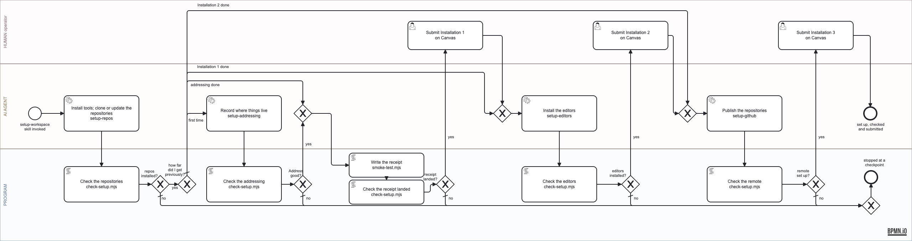

This is the course's setup workflow, as drawn for Installations 1 to 3. The picture shows the
diagram underneath its `Set up the workspace` box. Read that diagram only.

You can also open `workflows/bootstrap/bootstrap.bpmn` from your `course-materials` folder in
Camunda Modeler and click the small arrow button at the bottom-right corner of the `Set up the
workspace` box.

## Framing

An AI agent was asked to say in plain words what this plane of the diagram claims. Each question
below gives sentences from its summary about one element of the plane.

### next-arrow

An AI agent's summary of this plane says several things about the solid arrow from the rounded box
`Publish the repositories` to the rounded box `Check the remote`. Which one does the diagram
support?

1. After `Publish the repositories`, the next step is `Submit Installation 3`.
2. After `Publish the repositories`, `Check the remote` runs next.
3. After `Publish the repositories`, `Check the remote` runs next, done by the AI agent.
4. `Check the remote` runs before `Publish the repositories`.

### not-handoff

An AI agent's summary of this plane says several things about the run going from the rounded box
`Check the addressing` to the rounded box `Write the receipt`. Which one does the diagram support?

1. It is a handoff from a program to the AI agent, which writes the receipt.
2. It is not a handoff, since the AI agent does both steps.
3. It is a handoff, because a gateway sits between them.
4. It is not a handoff, since a program does both steps.

### handoff

An AI agent's summary of this plane says several things about the run going from the rounded box
`Check the editors` to the rounded box `Submit Installation 2`. Which one does the diagram support?

1. It is a handoff, from a program to the human.
2. It is not a handoff, because a gateway sits between them.
3. It is not a handoff, since a program does both steps.
4. It is a handoff, from a program to the AI agent.

### lane-step

An AI agent's summary of this plane says several things about the rounded box `Install tools`. Which
one does the diagram support?

1. A program does it, since its label names `setup-repos`.
2. The AI agent and a program both do it.
3. The human does it, since the human installs the tools.
4. The AI agent does it.

### split-after-remote

An AI agent's summary of this plane says several things about the diamond just after the rounded box
`Check the remote`. Which one does the diagram support?

1. Paths come back together here, and one path goes on.
2. The flow splits here, on `editors installed?`.
3. The flow splits here, on `remote set up?`.
4. The run takes both paths from here at the same time.

### merge-before-stop

An AI agent's summary of this plane says several things about the diamond just before the circle
`stopped at a checkpoint`. Which one does the diagram support?

1. The `no` paths from `repos installed?` and `Address good?` come back together here.
2. It is a decision: the run goes one way or the other here.
3. Only one path arrives here, from the diamond after `Check the remote`.
4. The `first time` path meets the others here.

### after-branches

An AI agent's summary of this plane says these things about the rounded box `Check the receipt
landed`. Is each sentence true or false of what the diagram shows?

#### a

"After `Check the receipt landed`, on `yes`, the next step is `Install the editors`."

1. True
2. False

#### b

"After `Check the receipt landed`, on `no`, the run ends in the circle `stopped at a checkpoint`."

1. True
2. False

### after-step

An AI agent's summary of this plane says several things about the rounded box `Submit Installation
2`. Which one does the diagram support?

1. After it, the next step is `Check the remote`.
2. After it, the next step is `Publish the repositories`.
3. After it, the next step is `Install the editors`.
4. After it, the next step is `Submit Installation 3`.

### after-last

An AI agent's summary of this plane says several things about the rounded box `Submit Installation
3`. Which one does the diagram support?

1. The run ends at `Submit Installation 3` itself, with nothing after it.
2. After it, the run ends in the circle `stopped at a checkpoint`.
3. After it, the run ends in the circle `set up, checked and submitted`.
4. After it, the next step is `Publish the repositories`.
