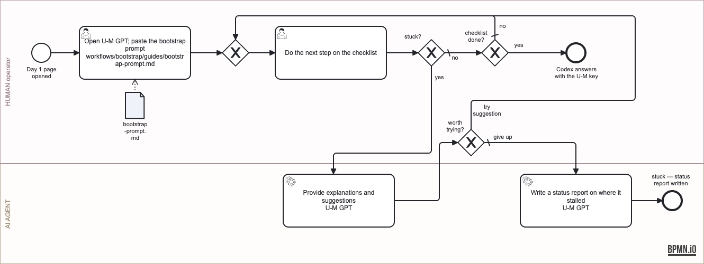

This is the course's setup workflow, as drawn for Installations 1 to 3. The picture shows the
diagram underneath its `Get Codex running` box. Read that diagram only.

You can also open `workflows/bootstrap/bootstrap.bpmn` from your `course-materials` folder in
Camunda Modeler and click the small arrow button at the bottom-right corner of the `Get Codex
running` box.

### one-split

Name one place where the flow splits. Point to it by the steps or gateways just before and after
it.

### branch-label

What does the label `no` on the arrow leaving the diamond just after `Do the next step on the
checklist` tell you?

1. a step named `no` runs right after the diamond
2. a run takes this arrow when the gateway's answer is `no`
3. the run ends here, with the outcome `no`
4. the work passes from this lane to another lane

### file-line

What does the dotted line between `bootstrap-prompt.md` and `Open U-M GPT` tell you?

1. the file is the next step
2. after that step, the run moves on to the file
3. the run ends at the file
4. that step reads, or uses, that file

### one-merge

Name one place where paths come back together. Point to it by the steps or gateways just before
and after it.

### after-loop

What happens after `Provide explanations and suggestions`?

### after-last

What happens after `Write a status report on where it stalled`?

1. `Provide explanations and suggestions`
2. `Do the next step on the checklist`
3. `stuck`
4. `Codex answers with the U-M key`
